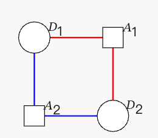
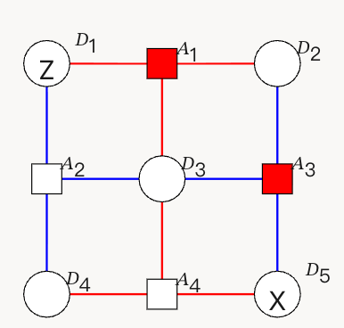
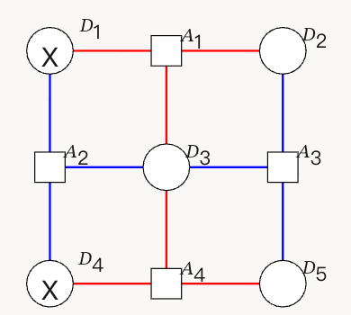
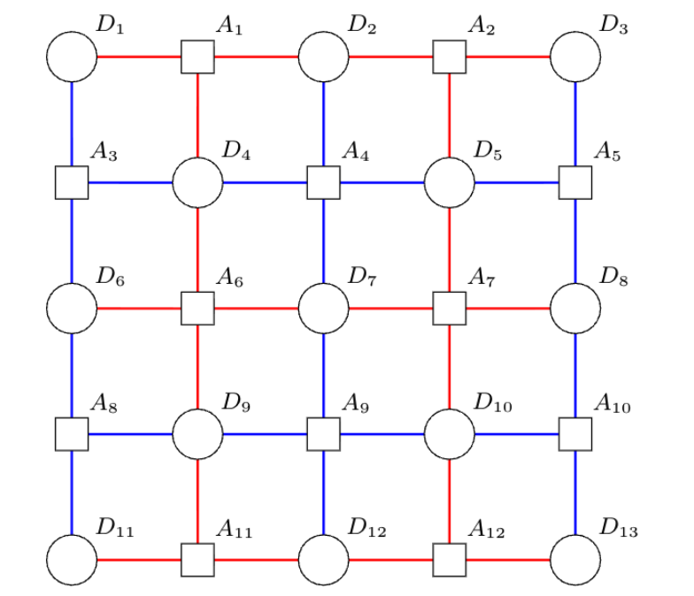

# 从经典纠错到量子纠错：基本概念与表面码入门

key words: quantum error correction

领域的动机：从经典计算机0、1比特，到量子比特，量子计算机将量子波函数包含在比特中，由于波函数相当于本征态的连续取值组合，这样的组合有无数种可能，原则上量子计算机编码能力可能超越经典计算机。  然而量子计算机始终无法逾越的困难在于： 如何保护、或者说隔离量子比特、使其免受环境噪声的影响、防止量子信息损失到不可恢复。因此量子系统非常脆弱。 这里面的困难主要涉及到测量塌缩。在量子力学中，波函数受到观测即塌缩到本征态，因此观测可能导致量子信息的破坏；另一方面，量子信息也不可以被复制。 一个东西既脆弱、又难以移植和干预，这些困难似乎已经宣告了量子计算的可行性的失败。  而自1995 年，人们通过额外的手段，以期实现某种主动纠错机制，在这种情况下，将量子比特的错误率压低至任意可以接受的程度，这给了量子计算一缕曙光。

## 经典纠错

纠错的基本原理是增加用于编码给定信息的比特数量，这种行为是冗余编码（redundant encode），实现冗余编码的具体方式由一组纠错码（error correction code）规定。

一个最简单的经典纠错码是直接让编码器（encoder）复制重复码，比如，Let

$$
0\longrightarrow 000,\qquad 1\longrightarrow 111
$$

一个bit的信息被复制三份。

假设信息在传输发生错误，接收方收到了$010$，则接收方依旧可以通过多数表决认为收到的信息是$0$。因此，可以认为定性上增加比特数“稀释”了这种错误率。而经典计算机中有数十亿个电子的差异，这使得经典计算机有很高的容错。

## 量子纠错

量子纠错想要直接 copy 经典纠错这一套规则是不可能的，于是量子纠错往前走了三步。

第一，像经典编码那样复制重复码是不可能的，不可克隆定理告诉我们的是，找不到任何一个Unitary演化，使得：

$$
U \ket{\psi} \otimes \ket{0} \to \ket{\psi} \otimes \ket{\psi}
$$

其中量子比特 $\ket{\psi}$ 被复制成$\ket{\psi}\otimes\ket{\psi}$。 然而， 这不可能。因此，必须寻求其它冗余编码的途径。

第二，尽管一般的错误可以离散化，并且被我们尽可能地简化成了 X-error, Z-error 两类，但依旧要同时检测这两类错误类型，X-error: Bit翻转类型和 Z-error: 相位翻转类型。

第三，纠错依旧是一种测量手段，是一种投影测量，需要谨慎小心选择测量，避免波函数塌缩抹除编码信息。于是从这里，须得引入稳定子码（stabilizer  code）

我们接下来会逐步介绍。

### 量子比特

量子的基本对象是波函数，在这里，量子比特取代经典比特：

$$
\ket{\psi}=\alpha\ket{0} + \beta \ket{1}
$$

它表示处于bit 0的概率是$\frac{\alpha^2}{\alpha^2+ \beta^2}$，而处于1的概率是$\frac{\beta^2}{\alpha^2+ \beta^2}$。 因此，量子比特可以连续地编码信息。 一个方便的可视化是量子比特住在一个bloch球上，相应的量子比特的位置转换成两个球坐标系描述。

但连续也意味着量子比特可能出现无穷多的错误的影响。这种影响直接的体现就是让量子比特在bloch球上移动了一个角度，数学上可由Unitary operator，即旋转操作表示：

$$
U(\delta \theta,\delta \phi) \ket{\psi} = \cos\frac{\theta + \delta \theta}{2}\ket{0} +e^{i(\phi + \delta \phi)}\sin\frac{\phi + \delta \phi}{2} \ket{1}
$$

一个关键的简化在于将Unitary操作离散化。

一个旋转角度可以分成好几步、好几个坐标视线，即 Unitary operator 变成一堆Pauli算符展开，即在Pauli basis上进行表示：

$$
U(\delta \theta,\delta \phi) \ket{\psi} \to \alpha_I \ket{\psi} + \alpha_X X\ket{\psi} + \alpha_Z Z\ket{\psi} + \alpha_{XZ} XZ\ket{\psi}
$$

其中Pauli Y已经借由对易子换成X，Z表示。因此原则上，一个错误只要识别 X-, Z-Pauli Error 两种贡献。

### Two Error Types

- X-Pauli error对应于bit翻转

  $$
  X\ket{\psi} \to \alpha\ket{1} + \beta \ket{0}
  $$

- Z-Pauli error对应于相位翻转

  $$
  Z\ket{\psi} \to \alpha\ket{0} - \beta \ket{1}
  $$

  这种相位翻转错误在经典没有对应物。

### 冗余 redundancy

前面我们提到，纠错的基本原理是增加用于编码给定信息的比特数量。

CNOT: 波函数可以通过CNOT门与新的bit作用，也就是将纠缠扩散至更多的bit，定义逻辑量子比特 (logic qubit)。换句话说，量子纠错中用 CNOT门建立冗余。

逻辑量子比特：一个物理的量子比特是 $\ket{\psi}$， 经由CNOT门，物理量子比特可以与新的qubit产生纠缠进而扩大所在的希尔伯特空间维度，即：

$$
\ket{\psi} \to \ket{\psi}_L = \alpha \ket{00}+ \beta\ket{11}
$$

我们称被encode后产生的 $\ket{\psi}_L$ 为逻辑量子比特，它的基态是 $\ket{0}_L$ 和 $\ket{1}_L$，所以它依旧扮演双逻辑的角色.  我们实际看的也是逻辑量子比特而不是物理的量子比特。这就是经典纠错的定性对比。 逻辑量子比特生活在 Stabilizer Code space 中，我们后面会介绍。

> Proof. 假设初始的量子比特为
>
> $$
> |\psi\rangle=\alpha|0\rangle+\beta|1\rangle, \qquad |\alpha|^2+|\beta|^2=1
> $$
>
> 第一步：引入一个辅助 qubit（ancilla）. 将辅助 qubit 初始化为 $|0\rangle$，整个系统成为
>
> $$
> \begin{aligned} |\Psi_0\rangle &=|\psi\rangle\otimes|0\rangle\\ &=(\alpha|0\rangle+\beta|1\rangle)\otimes|0\rangle\\ &=\alpha|00\rangle+\beta|10\rangle. \end{aligned}
> $$
>
> 第二步：施加 CNOT 门.  以第一个 qubit 为控制位（control），第二个 qubit 为目标位（target）. 比如控制位为 $|1\rangle$ 时，翻转目标位。于是
>
>
> $$
> \begin{aligned} |\Psi_1\rangle &=\operatorname{CNOT}|\Psi_0\rangle\\ &=\alpha\operatorname{CNOT}|00\rangle +\beta\operatorname{CNOT}|10\rangle\\ &=\alpha|00\rangle+\beta|11\rangle. \end{aligned}
> $$
>
>
>

逻辑量子比特不来自克隆：

$$
\ket{\psi}_L \ne \ket{\psi}\otimes \ket{\psi}
$$

编码（encode）的操作是将初态中的量子信息分布到纠缠的两方逻辑态$\ket{\psi}_L$ 上，这为编码引入了可借用于错误检错的冗余。

### 稳定子码 Stabilizer code

上面一个典型的例子，因为 $\ket{\psi}_L$ 显然是在一个total $2^2=4$维希尔伯特空间的二维子空间，与另外两个qubit $\ket{01},\ket{10}$的子空间正交。我们把另外的这个子空间叫错误码空间，显然它们来自于逻辑qubit空间发生X-Pauli error（可以在任何一个物理 qubit 上发生）

问题是具体如何区分出正确逻辑量子比特 $\ket{\psi}_L = \alpha \ket{00}+ \beta\ket{11}$ 和错误的码空间 $\{ \ket{01},\ket{10} \}$ 呢？我们依旧需要测量，并且找到一种聪明的测量，利用正交的性质，使得测量结果正好投影到其中的子空间，不会混淆错误的码和正确的码。 在这里，引入稳定子测量这一概念。

Stabilizer Code. 对于上例两个物理量子比特构成一个逻辑量子比特的情况中，稳定子只能是：

$$
Z_1 Z_2
$$

因为任意一个qubit出现了error会得到这个operator的本征值为-1，于是就此区分出来。所以检查错误相当于投影测量。

逻辑量子比特在稳定子作用下不变，考虑一个 general 的 Unitary 作用比如上式 $U=Z_1 Z_2$，作用在逻辑量子比特上，本征值是+1，于是我们称如同 $Z_1 Z_2$ 这样的 code 是 stabilizer code.  当然你可以不只是这两个物理比特编制的逻辑量子比特，你也可以有多个 stabilizer code，这些 operator 张成的空间就是 stabilizer code space.

在量子电路中的实际实现。 假设逻辑量子比特遭受bit翻转错误E，在错误阶段后，还需要引入一个辅助量子比特$\ket{0}_A$， “A” means ancilla, 以测量稳定子$Z_1Z_2$。 于是在电路的伴随式提取(Syndrome extraction) 阶段得到：

$$
E\ket{\psi}_L\ket{0}_A \to \frac{1}{2}(1_11_2 + Z_1 Z_2) E\ket{\psi}_L\ket{0}_A + \frac{1}{2}(1_11_2 - Z_1 Z_2) E\ket{\psi}_L\ket{1}_A
$$

当发生了error时，$E=X$任意位置上的X-Pauli error，于是第一项因为$1_11_2 + Z_1 Z_2$ 变成0，第二项保留，并且被辅助量子比特测量结果为1的状态提取到。若 $E=\{1, X_1X_2 \}$，则辅助量子比特的测量结果是0.  可以看到，一次 $X$ 错误可以被 syndrome 检测出来，但两次 $X$ 错误会逃过检测(检测不出来），但是发生两次错误的概率从 $O(p_X)$ 降到了 $O(p_X^2)$。

Syndrome extraction.  辅助量子比特的测量结果是Syndrome，它告诉我们是否遭受了错误。

推广到多个、更一般概率的错误类型时，

$$
E = \mathcal{E}_1 \otimes \mathcal{E}_2 = \alpha_I^2 1_1 1_2 + \alpha_I\alpha_X(X_1 + X_2) + \alpha_X^2X_1 X_2
$$

where $\mathcal{E}_1 = \alpha_I 1 + \alpha_X X$。 在本例中，这使得 syndrome extraction获得：

$$
E\ket{\psi}_L\ket{0}_A \to \color{green}(\alpha_I^2 1_1 1_2 + \alpha_X^2X_1 X_2) \ket{\psi}_L\ket{0}_A \color{red}+ \alpha_I\alpha_X(X_1+X_2)\ket{\psi}_L \ket{1}_A
$$

两量子比特无法区分出到底是谁发生了X-error，因为你只能获得$Z_1 Z_2$的负本征值。

- 自然推广到三量子比特纠错码，那么最小的稳定子是：

  $$
  Z_1 Z_2,\quad Z_2 Z_3
  $$

  于是也可以引入两个辅助量子比特$\ket{0}_{A1}, \ket{0}_{A2}$，通过syndrome提取组合出的结果 $s_1s_2$ 可以唯一知道是哪个qubit发生了X-Pauli error

- 推广到任意稳定子码结构时，对于每个稳定子$P_i$，应有：

  $$
  E\ket{\psi}_L\ket{0}_A \to \frac{1}{2}(1^{\otimes n} + P_i) E\ket{\psi}_L\ket{0}_A + \frac{1}{2}(1^{\otimes n} - P_i) E\ket{\psi}_L\ket{1}_A
  $$

  因此，若稳定子码 $P_i$ 与错误 $E$ 对易，则syndrome=0, 若反对易，则 syndrome=+1.

### 相位翻转错误

然而以上均讨论的是X-Pauli error的识别。四量子比特纠错码是最小的能够同时识别X-，Z-Pauli error的最小稳定子码。它编码了两个逻辑量子比特，其最小的稳定子群为:

$$
\mathcal{S}_{[4,2,2]} = \langle X_1 X_2 X_3 X_4, Z_1 Z_2 Z_3 Z_4\rangle
$$

其中$[4,2,2]$对应到[n,k,d]表示4物理量子比特，2逻辑量子比特，2码距；发生任意单量子比特error时，X或Z error type都与上面的稳定子群反对易，因此可以被检测出来。  不过，本例可以同时检测两种类型的error，但依旧不是完全纠错，无法识别具体是哪个bit发生了error。

### 纠错

知道了是否发生错误还不够，最好是能识别出具体的错误，并“反”作用回去。

decoder处理syndrome，选择能让逻辑态返回码空间的Unitary操作，使得：

$$
RE\ket{\psi}_L = \ket{\psi}_L, RE =P, P\in \mathcal{S}
$$

- 这里，$R,E$都是Unitary operator
- $R$不一定就是发生错误的operator，即恢复操作并不唯一，不需要严格满足：$U^\dagger E=1$.
- $RE$作用结果属于稳定子群$P \in \mathcal S$.

举个简单的例子，前面的四量子比特纠错码的稳定子群我们已经知道了。对于发生的任意单量子比特错误，该纠错码能识别类型，比如，如果发生$X_1$，那么$E=X_1$。 如果能进行纠错 $R=X_1$固然是好，但不一定就刚好是这个 Unitary operator，稳定子纠错$R=X_2X_3X_4$，虽然与原错误不同，但是

$$
RE = X_1X_2X_3X_4 \in \mathcal{S}
$$

因此，量子态依旧恢复了。

如果纠错使得 $R=X_1X_2X_3$，虽然该纠错最终的结果是返回到码空间，但由于不属于$\mathcal{S}$，因此实际上态还是被改变了，纠错是失败的。

## 表面码

表面码是一种主流的构造方法：

1. 具有一组相互对易的稳定子，能够在不扰动编码信息的情况下检测错误。
2. 表面码属于拓扑码。拓扑码的一般设计原则是通过将重复单元拼接一起构造码。
3. 表面码的构造仅需要最近邻相互作用，而许多量子计算平台无法在量子比特之间实现高保真度的长程相互作用，这也是表面码的优势。

### 最小的表面码：环面码

回想四量子比特纠错是如何做到能够同时检测 X-Pauli 和 Z-Pauli error 的？现在尽可能回到最小的局域单位，我们依然构建：

$$
X_1X_2, Z_1Z_2
$$

这样两种稳定子互相对易，可以独立测量；只不过，四环表面码并不是一个有效的码，只是作为表面码基本组成单元的演示

这样的码基本单元能够保证同时检测两种错误，X 和 Z 错误

- 其中$D_1,D_2$是编码量子比特，$A_1,A_2$是两个辅助 syndrome 提取的辅助量子比特
- 红色线表示 control-X，蓝色线表示 control-Z

### [[5, 1, 2]] 表面码

这是 4 个四环拼接：

- 单量子比特 error 由某个 bond监测

  - 图中 D1 发生 Z 型相位错误，就会被旁边的 A1 检测出来；D5 发生 X 错误，被 A3 检测出来。这是正常的，回想我们如何通过 ZZ stabilizer code 检测 X 型bit 翻转……

- 同边如果发生同样的 error，这种错误检测不出来！

  - 这相当于 A2 被翻转了两次，所以综合显示不出错误的结果

我们看到，如果出现 error 贯穿一条边的情况就会检测不出来。但是进一步拼接后，这种错误所需要的条件会被进一步严格降低，因为只有抵达边界的整条线上每个都发生 error 才存在检测不出来的情况。 Generally,  我们可以想象如果不是到达边界，而是在体内存在 syndrome 头尾是什么样的情况——这的确和 directedloop 类似，让我们做一个比喻，这有点像是全开边界的 directed loop： syndrome propagation

$$
\partial E = syndrome
$$

到达边界的这种情况，会使得比如：

$$
E\ket{+}_L = \ket{-}_L
$$

态完全发生改变，但 syndrome 无体现。

### Toric Code
Toric code的基本单位是一个 5 量子比特纠错码，不是四环。Toric code 关注的单位里，qubit 是放在边上的，因此又分为

- 顶点检验：$A=\prod_i X_i$，比如图中以 A6 为中心的十字中心
- 面元检验：$B=\prod_i Z_i$，比如图中以 A6 为中心的面元 A3-D4-A4-D7-A9-D9-A8-D6-A3.

本节只是提一下以上表面码完全可以是 Toric code 的“晶格”，Toric Code 不在这里更进一步讲解。

### 纠错的实际能力

测量一个 [[n,k,d]] 码的稳定子会产生 m 个 syndrome，其中 m=n-k，也就是 n 个物理量子比特减去 k 个逻辑量子比特的数量，比如考虑一个 41,1,5 的拼接表面码，为了纠错就需要在 $2^{m}=2^{40}$ 种错误可能性中查表，这显然是不可能实现的

码阈值的实际考量出于这种扩大拼接的能力和设计相应的量子纠错码是否值得。实际的衡量标准是，扩大的更大规模的码具有更低的逻辑错误率。

1. 码中各个量子比特的物理错误率低于阈值 threshold，增大码距就会相应的降低逻辑错误率
2. 因此原则上是要求这个阈值的上界到底是多少。
3. 在给定噪声的模型下，可以利用统计力学的方法求得其阈值 p 的上界。**从这里开始，作为 QEC 与 SWSSB 这条线汇合之处：量子纠错的阈值与混态相变的关系。**
