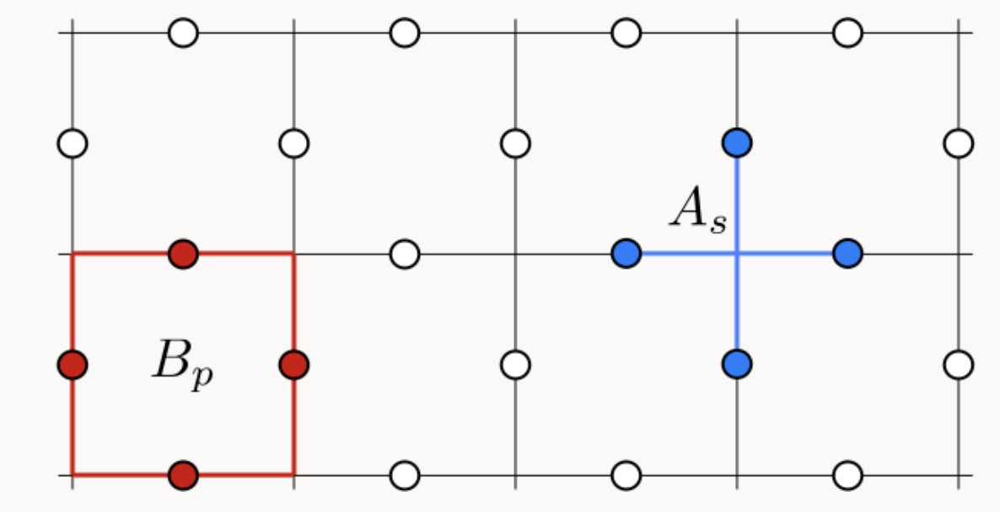
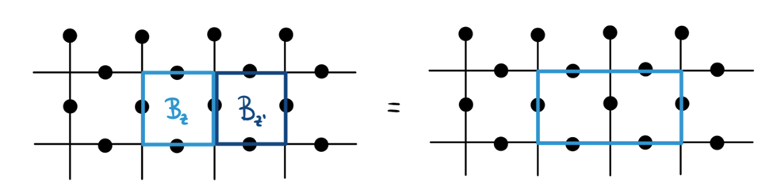
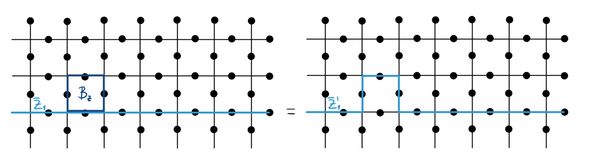
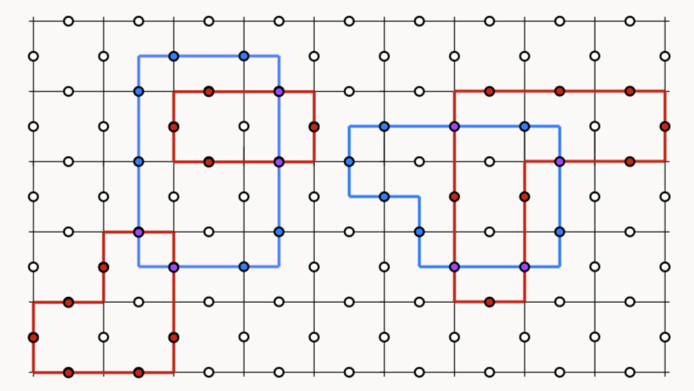
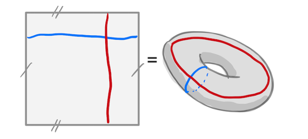
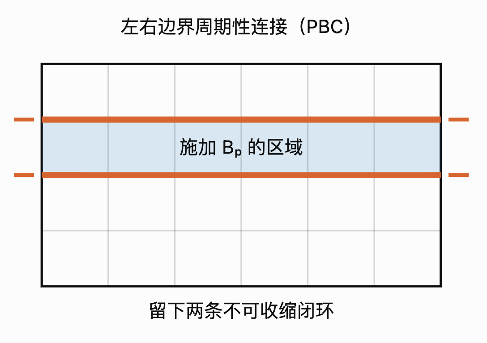
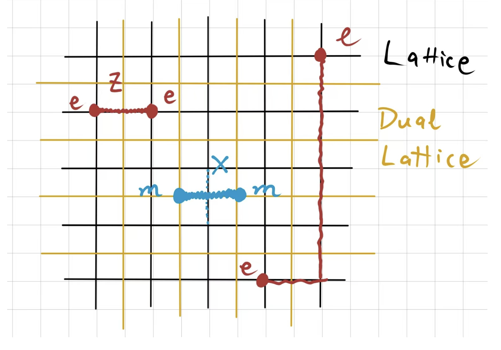
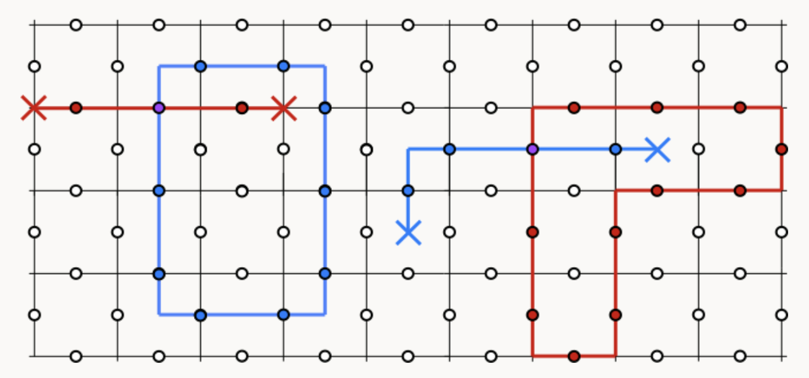
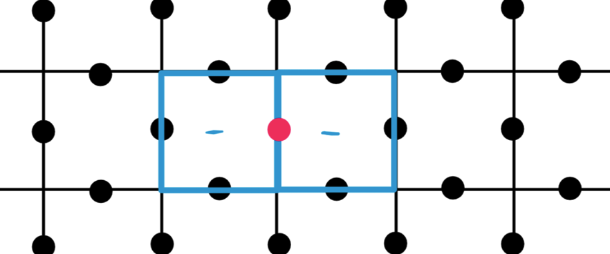
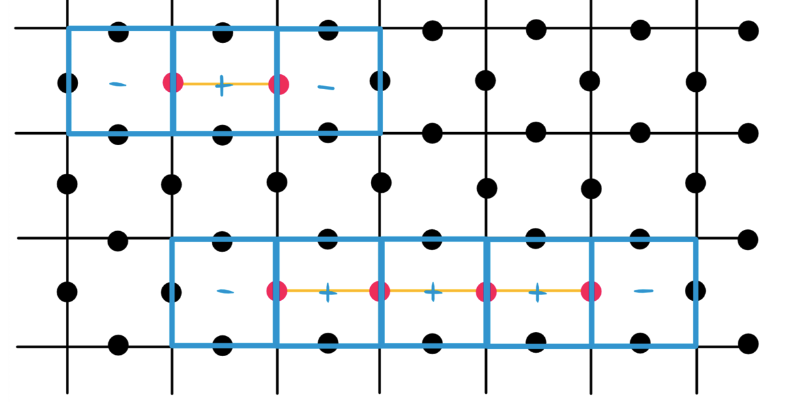

# 表面码与 Toric Code：Part I

动机：

----

然而，Toric code 作为...的必经之路，很多系统性介绍的讲义...，本文不致力于令人醍醐灌顶，而是先筛选并呈现那些值得我们注意到的事。

1. 什么是 Toric code，当我们提及 Toric Code 时，通常意味着什么：
   1. 哈密顿量
   2. 基态
   3. 激发态？
   4. 对称性
   5. 相变
2. 如何从量子纠错 - 表面码 - Toric Code 这条主线来进行理解
3. 对于 Toric Code 本身，人们还关注什么问题

----

## Toric Code

### Hamiltonian and Lattice

$$
H_{\rm TC}=-J_e\sum_v A_v-J_m\sum_p B_p,
$$

一个最直接了当的 Lattice 图像是：

- $A_v$ 我们称为顶点项 (vertex): $A_v = \prod_i X_i$
- $B_p$ 我们称为面元项 (plaquette) $B_p=\prod_{i\in\partial p}Z_i$.

由于这些 Pauli 算符累乘偶数个，因此两项彼此对易，即便顶点项和顶点项会在某些 bond 上重合，也一定只会重合偶数个 bond，所以依旧是彼此对易的。

### Ground State

由于我们说哈密顿量中的每一项都对易，那么基态必然是同时满足面元项和顶点项的构型的叠加态。

单纯看面元项或者顶点项我们都可以得到很多高度简并的基态。比如，如果只看顶点项 $(B_p << A_v)$， 基态要求这些构型都形成顶点类型的闭合环；同样，如果只看面元项，这些不同的 B 类闭合环构型都是高度简并的基态。

下图演示我们如何作用两个 plaquette 得到更大的封闭 loop，两个 plaquette 都作用后得到 $\prod_p B_p\ket{\psi} = +1 \ket{\psi}$ 的本征值。

于是我们只是天真地想，必须同时满足面元项和顶点项，那么基态无非是各种合法闭合回路的等权叠加，然而这样的基态似乎并不简并，那么简并来自于何处呢？

$$
\ket{\Psi_0} = \sum \ket{\ell_1} + \ket{\ell_2} + ...
$$

从一个一开始只是 $\prod_v A_v$ 的本征态出发开始考虑，事情是会变得更简单的。然后我们在考虑 $B_p$ 的作用。

我们第一个需要思考的是， $B_p$ 能否把所有满足 $A_v=+1$ 的闭合环构型都联系起来？

图中演示了一种 $B_p$ 为构型进行形变的过程，此时忽略实际几何和更大的 $\bar{Z}_1$ 长什么样。

显然通过施加 $B_p$ 会对构型进行形变，把 loop reshape。 如果两类都是闭环，不难想象互相穿过的次数一定是偶数次。 （我们后面会介绍，在某些情况和有 defect 的情况下会发生奇数次交叉）

$B_p$ 的作用是翻转一个 plaquette 的四条边上的自旋，对已有的闭环进行局域的自旋修改，只不过改变偶数次所以体现在 $A_v$ 上时负号不变，依旧是 $A_v$ 的本征态构型。 然而，构型切实地改变了，因此我们说，$B_p$ 实际上能够对闭合环做的操作，就是把一种闭环构型变成另一种闭环构型。 （是否把任意一种变成另一种，这恰恰是我们没有证明的事情！）

我们依然没介绍简并来自何处，但是请先接受 $B_p$ 可以让构型形变这一点。 接下来直指核心：这种操作在平面和 torus 上是否存在本质区别？在平面上，我们清晰地看到两种环的交叉情况。现在假想这些环我们能“人为”地收缩扯动——本来也如此，考虑各种可能的合法构型——这种情况，我们发现这些环要么相交偶数次，要么不相交。

现在问：这两种 loop 能不能只相交一次？

##### *Topological Order*

一个 Torus 是 x,y 方向都具有周期性边界条件的几何。所以当我们注视着平面上的某个红色闭环、某个蓝色闭环时——这需要一点3d 想象能力，蓝色闭环当然可以竖着绕过甜甜圈，红色当然可以横着绕过甜甜圈，但因为流形的拓扑（洞）的限制，这两种环不可能收缩，都必须且只能相交一次。  --> 当然，如果此时你再把 torus 展平，它相当于此时的顶点项和面元项各自构成的是连通边界的闭合回路。（我觉得这里非常容易与 string 这种概念混淆，但一定不能说成 string，因为展平是为了方便看相交，但不可能真的展平以呈现两种路径的端点，它们没有端点，它们是闭合回路。）

*Comment: 这里的概念过渡关键在于不要从平面的闭合角度来理解 torus 上的事。不能简单理解平面的 loop 移植到 torus 上，后面还会由 $B_p$ 无法作用出这种 loop 来映证这一点。*

---

暂时不区分红色、蓝色，只考虑同一种闭环。对于 torus 的两个独立方向，分别定义：

$$
(n_x,n_y),\qquad n_x,n_y\in\{0,1\}
$$

其中：

- $n_x=0$：沿 $x$ 方向绕行的总奇偶性为偶数；$n_x=1$：奇数。
- $n_y$ 同理。

我们已经找到了两种：$(1,0)$ 和 $(0,1)$。  当然还有剩下两种：(0, 0), (1, 1)。

---

当让数学上你当然可以列举这不同的四类，对应于物理图像是什么呢？可能以为是两种颜色各自竖着横着绕过 torus 来一遍吧——其实完全牛头不对马嘴。

这四种拓扑是：

- 所有 loop 都在 bulk 内， 或者不可收缩的 loop 必须偶数次绕过边界 （这可以由 $B_p$ 从边界成对作用出偶数不可收缩 loop；后文会有介绍）
- A 类有奇数次的不可收缩 loop；B 类无或偶数
- 上条反之
- A、B 类都有奇数次的不可收缩 loop 且方向不同地交叉

稍微具体介绍面元项导致的光滑形变是什么？如何导致构型的连接？ 想象我们在 torus 上，沿水平方向连续翻转一整圈 plaquettes：

因此，面元项**无法改变环的绕数的奇偶性**。这里强调奇偶性是指，面元项可以改变绕数，但是它只能将一个闭环变成沿环面某个非收缩回路的一对环。这里衍生出下一个问题：

- 每个合法闭环构型确实满足 $A_v=+1$。
- 但单个闭环构型不一定满足 $B_p=+1$，因为 $B_p$ 会把它变成另外的构型。

显然，我们要把所有同一个拓扑类别的构型考虑到，才能够得到 $B_p$ 的本征态

#### 简并拓扑态储存量子信息

由于这些拓扑简并性无法通过任何合理的局域微扰解除，因此可以用于稳健地储存量子信息。

正如我们上一章节介绍的，量子信息面临的主要挑战是量子退相干问题，即在环境的噪声影响下尽可能保存量子信息包括量子相干性。 拓扑量子计算提出以此抵抗退相干，具体来说，这就是超导量子比特实验正沿着表面码的推进目标。

### 激发

在基态上如何考虑激发？ 回想我们一开始理解 Ising model 时怎样寻找激发的？我们先尝试翻转一个自旋，计算能量的 cost，结果发现这并不是第一激发能，更小的能量是 kink …… Anyway,  这并不妨碍，当我们考虑激发的时候总是先从 flip 某个东西开始思考起。 忽略顶点还是面元什么的相互作用细节，粗糙地想，这就是个铁磁 Ising type 的哈密顿量。所以 only one flip，使得其中某个，A 或者 B 类型term，从原来的 $+1$ 变成 $-1$，那能量就被升高了。 从物理图像上来看，这就像是闭合环被打破了。当打破一个环，你总是留下两个断口，所以体现上就像是两个 defect.  只不过这里的 defect 到底是什么物理意义呢？

从物理的角度来考虑，假设我们实际作用一个 $Z_i$ 到基态上，比如 $=Z_i|\Psi_0\rangle$.  $Z_i$ 并不会改变任何的 z-basis 基底，但是这样的测量会改变量子态的相对相位，即：

$$
|+\rangle=\frac{|0\rangle+|1\rangle}{\sqrt2} \to Z|+\rangle=\frac{|0\rangle-|1\rangle}{\sqrt2}=|-\rangle.
$$

回到 Toric Code, 回想 Hamiltonian 中的 $-J_e A_v$ 项，

$$
A_vZ_i|\Psi_0\rangle =-Z_i A_v|\Psi_0\rangle =-Z_i|\Psi_0\rangle
$$

其中 $v$ 是边 $i$ 的一个端点。因此，$Z_i|\Psi_0\rangle$ 的确变成了 $A_v=-1$ 的本征态。 Single $Z_i$ 发生在一个 bond 上，会导致两个激发，因为有两个 vertex 的中心会 share 这样的 error bond。 我们说了，激发必须成对出现，在 Torus 上，这由两个方向的 PBC 保证的两个全局约束导致

$$
\prod_v A_v = 1, \quad \prod_p B_p = 1
$$

所以你不能出现单个的 $A_v=-1$，还得再有一个。

因此最低激发能为

$$
\Delta=\min(4J_e,4J_m).
$$

当 $J_e=J_m$ 时，两类激发具有相同能量。

#### 与 QEC 的联系

以上激发可以考虑的是某个边发生 X类型的错误或者 Z 类型的错误。比如，我们已经知道基态满足

$$
A_v|\Psi_0\rangle=B_p|\Psi_0\rangle=|\Psi_0\rangle.
$$

现在假设我们对某条边 $i$ 施加 $Z_i$，构造一个新态：

$$
|\Psi'\rangle=Z_i|\Psi_0\rangle.
$$

按照我们目前的定义，$Z_i$ 错误会被 $A_v = \prod_iX_i$ 检测到。

##### *Wilson Loop*

既然类似于一维 Ising model 中翻转一段自旋，只在两端留下 kinks，这里连续施加 $Z_i$，也只会在 string 两端留下 defects。我们紧接着可以介绍 Wilson loop 的物理图像。

可以定义两个类型的 WL：

$$
W_e =\prod_{i\in\gamma}Z_i , \quad W_m = \prod_{i\in\gamma}X_i
$$

其中 $\gamma$ 是连接两个 defect 的中间路径。因此，WL 是沿着电路径和磁路径的自旋算符积分。  回想我们怎么定义 Confine 和 Deconfine，wilson loop 不能自由拉长，通常由哈密顿量决定，如果 WL 有一个线性势正比于长度，那么两个激发只能 confine 在最短的路径上。 所以 Toric Code 中的激发是 deconfined 的.  Deconfinement 意味着两个激发之间不存在随距离增长的禁闭势。

注意，Wilson loop 虽然叫 loop，但更像是 string ...

- 因此，两个 defects 的连接路径有很多种可能

如果我固定两个 defects 的位置，却选择两条不同的路径 $\gamma_1,\gamma_2$ 连接它们，会发生什么？

$$
W_e(\gamma_1)|\Psi_0\rangle,\qquad W_e(\gamma_2)|\Psi_0\rangle.
$$

不同路径不一定对应不同量子态。假设两条路径 $\gamma_1,\gamma_2$ 连接同样的端点，那么

$$
W_e(\gamma_1)W_e(\gamma_2) =W_e(\gamma_1\oplus\gamma_2).
$$

右边就是两条路径合起来形成的闭环（重合的边因为 $Z_i^2=1$ 而抵消）。

1. 如果闭环可收缩，它可以写成若干 $B_p$ 的乘积，因此两条路径作用在基态上得到同一个态。[^appendix-1]

2. 如果闭环不可收缩，情况就不同了：它可能改变基态的拓扑扇区。

   不可收缩 Wilson loop：沿 torus 周期方向绕一圈，不能表示成 plaquette operators 的乘积。 即使后一种不可收缩的 $Z$ loop，也不会破坏任何 $A_v=+1$ 或 $B_p=+1$ 的条件。它改变的可以是另一种与它相交的非局域 Wilson loop 的本征值，而不是局域稳定子的本征值。

考虑构型中有超过两个的 defects /多条 WL，那么它们的交叉情形也值得考虑：

1. 对于同类型的 $Z$ strings，交叉点不自动产生 defect。关键是每个顶点连接的被翻转边数的奇偶性，而不是图形上是否交叉。
2. 至于不同类型的 $e,m$ strings 相交，确实会产生更有意思的结果，我们稍后讨论。

接下来我们的逻辑是：

1. Wilson loop：如何检测激发？ 我已经有了 $e,m$ defects，怎样判断一个区域内有没有它们？

2. Wilson path：如何移动激发？ 我知道激发在哪里，但怎样把它们从 $a$ 移动到 $b$？

3. Anyon statistics：移动激发有什么特殊后果？ 如果让一个粒子绕另一个粒子一周，会发生什么？

类似于 wilson loop，我们定义 Wilson Path：

$$
W_e=\prod_{\mathcal l_e}\sigma^z,\qquad \Gamma^{(e)}=\prod_{a\to b}\sigma^x.
$$

$W_e$ 和 $\Gamma^{(e)}$ 虽然都带有 $e$，但并不是同一种算符！ 前者用于测量 $e$ 激发，后者用于移动 $e$ 激发。
我们可以用 directed loop 类比： $\Gamma$ 类似 worm：产生两个端点，移动其中一个端点，最后也可以让两端重新汇合。 $W_e$ 类似一个测量算符：检测闭合路径包围的区域内是否存在 $e$ defect，给出相应的 $\pm1$ 本征值。

我们考虑同一个 string operator：

$$
\Gamma^{(e)}(\gamma)=\prod_{i\in\gamma}X_i.
$$

根据路径的不同，它可能产生三种结果：
1. 开放路径：两个端点出现 $e$ defects，因此得到激发态。
2. 可收缩闭合路径：没有端点，也不产生激发，在基态空间内相当于恒等操作。
3. 不可收缩闭合路径：同样没有端点，不产生激发，但可以把一个基态变成另一个拓扑简并的基态。

##### *Anyon Statistics*

前面我们介绍了拓扑简并基态，但就激发而言，它们是否具有与分数量子霍尔效应系统中的电荷类似的拓扑性呢？  我们还是考虑 defect的移动路径（WL），区分两种情况：

- 同类型路径相交：$X$ 与 $X$，或者 $Z$ 与 $Z$，彼此对易。
- 不同类型路径相交：如果它们在一条物理边 $i$ 上交叉，就涉及 $X_iZ_i=-Z_iX_i$。

这意味着，当两种路径恰好交叉一次时，

$$
\Gamma_e\Gamma_m=-\Gamma_m\Gamma_e
$$

这意味着：

| 过程                            | 获得的相位 | 物理含义                   |
| ------------------------------- | ---------- | -------------------------- |
| 交换两个 $e$，或两个 $m$    | $+1$     | 各自是玻色子               |
| $e$ 完整绕 $m$ 一圈         | $-1$     | 非平凡的 mutual statistics |
| 交换两个 $\epsilon=e\times m$ | $-1$     | 复合粒子是费米子           |

第三件事可以通过前两个推导出来：

$$
\underbrace{\theta_{\epsilon}}_{\text{复合粒子交换}} = \underbrace{\theta_e\theta_m}_{\text{exchange}} \underbrace{M_{em}}_{\text{相互编织}} =(+1)(+1)(-1)=-1.
$$

直观地说，当你交换两个 $em$ 复合粒子时，不仅交换了两个 $e$ 和两个 $m$，还会涉及 $e$ 与 $m$ 的相互编织，因此复合粒子表现为费米子。[^statistics]

因此，我们到目前为止回答了一个问题：能否构造一个简单、严格可解的量子多体模型，同时表现出拓扑简并基态和非平凡的激发统计。 接下来，我们知道了四重简并，却没有真正证明为什么局域噪声无法区分这些基态，以及意味着可以保护量子信息。

*备注: 本文所有图均非原创，而是来自讲义中的截图。

---

统计过程对照。[^appendix-2]

---

## Toric Code 与 QEC

上一节我们已经介绍了 Stabilizer Code 和纠错的一些基本原理，甚至开始引入表面码（不过没有进入多少），这次我们希望建立这条主线：量子纠错 → Surface Code → Toric Code 的物理联系。

首先，量子纠错并不必须依赖 Pauli Group。 但是我们接下来选择讨论的，都是标准的 qubit stabilizer code 选择的 Pauli 算符，因为它们同时具有几种特别适合纠错的代数性质。 假设我想定义两个 stabilizer, 并希望找到它们共同确定的非零 code space:

$$
S_1|\psi\rangle=|\psi\rangle,\qquad S_2|\psi\rangle=|\psi\rangle.
$$

那么它们需要满足的性质就是对易。Pauli Group 最直接被利用的性质就是这些 Pauli 算符要么对易要么一定反对易。 Stabilizer 需要互相对易以定义同一个公共码空间。所以 stabilizer code 是 Pauli Group 的子群。 对于单个稳定子 $S$，我们有：

$$
SE=\begin{cases} +ES &\Rightarrow \text{syndrome}=+1\\ -ES &\Rightarrow \text{syndrome}=-1 \end{cases}
$$

所以如果错误类型与 $S$ 对易，我们就检测不到错误。 只不过，检测不到错误，不一定意味着纠错失败。
一个与所有 stabilizers 对易的错误 $E$，可能有两种情况：
- $E$ 本身属于 stabilizer group：它实际上不改变编码态。
- $E$ 是非平凡的 logical operator：它改变了编码信息，却无法被 syndrome 检测。

假设两个独立的稳定子 $S_1,S_2$，现在再引入 $S_3=S_1S_2$，测量 $S_3$ 不会提供任何新的 syndrome 信息。 Linear independence 的一个直接目的，就是找到一组最小的、没有冗余的 generators。 与此同时，我们能确定 code space 的维度。 如果有 $s$ 个独立且对易的 Pauli stabilizer generators，每一个独立的 $+1$ 约束都会把允许的空间维度减半：

$$
\dim\mathcal H_{\mathrm{code}}=2^{n-s}.
$$

因此，能够编码的逻辑量子比特数为

$$
k=n-s
$$

考虑 Toric code, 在一个 $L\times L$ 的 torus 晶格上，有 $2L^2$ 个物理 qubits、$L^2$ 个 vertex stabilizers 和 $L^2$ 个 plaquette stabilizers, 如果直接套用 $k=n-s$，似乎得到 $k=0$。但我们明明知道 Toric Code 有四重基态简并，这个四维基态空间可以编码两个逻辑量子比特，即 $k=2, 4=2^2$.  原因在于这 $2L^2$ 个 stabilizers 中，恰好有两个约束不是独立的。看看这两个约束来自于哪里。

以 vertex stabilizers 为例子，假设 torus 上有 $L^2$ 个顶点：

$$
A_1,A_2,\ldots,A_{L^2}.
$$

由于 PBC，每条边恰好连接两个顶点。所以，当我们把所有 $A_v$ 相乘时，每条边上的 Pauli 算符都出现两次，因为有 $\prod_v A_v=I$，所以

$$
A_{L^2}=A_1A_2\cdots A_{L^2-1}
$$

最后一个 $A_v$ 完全由其他 $L^2-1$ 个决定！ plaquette stabilizers 也类似。
- 在开边界的时候 ... 全局约束变成 1，不过 stabilizer 的数量也会变： $\ell = L^2 + \color{red}(L-1)^2 - 1$ ... $d = 1$ 只有一个 stabilizer state. plaquette stabilizer 的数量会变化。
这也是为什么我们考虑 surface code 的边界设计， 这是后话。

我们现在知道 $S_i|\psi\rangle=|\psi\rangle$， 如果我想在不离开 code space 的情况下，把编码的 $|\bar0\rangle$ 变成 $|\bar1\rangle$，需要引入什么样的算符？
1. 该算符 $\bar{X}$ 应当与 stabilizers 对易
2. 但它不能是 stabilizer group 的一个元素，否则不会改变编码信息
因此，联系到 toric code 上，只有不可收缩的闭环无法表示为 plaquette stabilizer 的乘积，这种非平凡的逻辑操作可以在 code space 内改变编码信息。

- 找到逻辑操作 → 逻辑操作不依赖具体路径 → 最短非平凡路径决定 code distance。
- Toric code 有 4 种 logical operator. Logical operator 是一类在 code space 内作用相同的算符。
- 所以对于 Toric code 来说，因为 logical string 必须绕 torus 的非收缩方向一周，所以在 $L\times L$ 晶格上，最短也需要经过 $L$ 条边。

顺便一提。我们回答上一节我们遗留的一些概念具体的物理含义，比如，码距到底意味着什么。假设一个错误算符 $E$ 作用在少数几个物理 qubits 上。只要它不能实现非平凡的 logical operation，编码信息就不会因此发生无法检测的逻辑改变。 显然，对于 $L\times L$ 的 Toric Code，最短的非平凡 logical string 长度为 $L$。

既然 logical operator 至少需要作用在 $L$ 个物理 qubits 上，是否意味着 Toric Code 可以纠正任意 $L-1$ 个物理 qubits 上的错误？ 不能。不同错误可能产生相同的 syndrome，仅靠 syndrome 不可以区分。
对于码距为 $d$ 的量子纠错码：
- 可以检测所有权重小于 $d$ 的 Pauli 错误。
- 可以保证纠正任意不超过 $t=\lfloor(d-1)/2\rfloor$ 个物理 qubits 上的错误。
- 对于 Toric code

$$
t=\left\lfloor\frac{L-1}{2}\right\rfloor
$$

我们需要从物理上理解这件事。 假设一条长度为 $L$ 的不可收缩 logical string，被分成两段：

$$
\bar X=E_1E_2.
$$

其中 $E_1$ 作用于其中一段，$E_2$ 作用于剩下的一段。假设 $E_1$ 长度为 $2$，$E_2$ 长度为 $L-2$。在独立且低概率的物理错误模型下，解码器通常会选择较短的路径进行纠正，所以最后形成类似于 (L-1)/2 的直觉。

----

### Appendix 2.1

如何把量子纠错转化成一个可以用经典计算处理的线性代数问题？ 假设三个 qubits 的稳定子是：

$$
S_1=Z_1Z_2,\qquad S_2=Z_2Z_3.
$$

写成矩阵是：

$$
H_Z= \begin{pmatrix} 1&1&0\\ 0&1&1 \end{pmatrix}.
$$

现在假设发生错误 $E=X_2$，用二进制向量表示：$\boldsymbol e=(0,1,0)^T$. 那么 Syndrome 表示

$$
\boldsymbol s=H_Z\boldsymbol e\pmod 2
$$

mod 2 表示只关心最后的奇偶。
给定测量得到的 syndrome，我们怎样反推出发生了什么错误？
1. 检测：已知错误 $\boldsymbol e$，计算 syndrome $\boldsymbol s$。这是矩阵乘法。
2. 解码：已知测量结果 $\boldsymbol s$，反过来寻找错误 $\boldsymbol e$。这是求解线性方程。 只不过这不一定有唯一解。

如果有多个解，我们可以选择：

$$
\boldsymbol e^* =\underset{H\boldsymbol e=\boldsymbol s}{\arg\min} \sum_i e_i
$$

这里的 $\sum_i e_i$ 称为 Hamming weight（汉明重量），就是发生错误的 qubits 数量。所以：
- 几何视角：寻找连接 defects 的最短错误路径。
- 线性代数视角：寻找满足 syndrome 方程、Hamming weight 最小的错误向量。

----

Toric code 具有实际的优势在于每个 stabilizer 都是局域的，或者说，最近邻相互作用。 因此抽象的纠错问题转化成了二维晶格上的局域缺陷检测问题。

这里可以深入探讨的是从 stabilizer code 到多体物理（或者说一个具有哈密度量的系统）的视角转换。

> 假设我们已经设计了一组 stabilizers, 它们可以定义一个 code space. 但是这只是告诉了我们哪些态可以编码量子信息，如果它们可以存在于一个物理系统，怎么样能告诉我们这些态在物理系统中为什么特殊？

所以，如果可以构造一个哈密顿量用以描述这些 stabilizers，我们相当于找到了这个哈密顿量的基态，ground state space 也就与 code space 建立起了联系。 引入 Hamiltonian 就需要考虑一些事情，比如：
1. 能量稳定性：离开 code space 是否需要付出能量？Hamiltonian 可以提供能隙。
2. 对局域微扰的稳定性：加入 $H'=H+\lambda V$ 后，原来的基态简并是否仍然受到保护？
3. 对环境噪声的稳定性：与环境交换能量、发生退相干时，量子信息能保存多久？有能隙也不保证能够自纠错。

Toric Code 的拓扑保护并不是只在某个特殊 Hamiltonian 与 torus 几何的组合下才成立。我们需要区分：
- Hamiltonian：决定系统是否处于拓扑有序相。
- Torus 几何：使这种拓扑序表现为四重基态简并。
- 局域不可区分性：使局域算符无法区分或直接连接不同的拓扑基态。

特别是二维 Toric Code：它具有能隙和拓扑基态简并，对足够弱的局域 Hamiltonian 微扰具有稳定性，**但在有限温度下并不是自纠错量子存储器**

### Toric code 上的纠错

我们先考虑一个物理 qubit 发生 $X_i$ 错误。 对于 $B_p=\prod_{j\in\partial p}Z_j$ 原本具有 +1 本征值的本征态，一条边 $i$ 同时属于几个 plaquettes？当我们施加 $X_i$ 后，这几个 $B_p$ 的本征值分别会如何改变？答案是 2.

红色的点所在的这条 bond 发生错误，而有两个 plaquette 共享这个错误的边，我们标记的两个蓝色 Plaquette 为“-”表示此时它们的本征值变成 "-1".

对于单个 $X_i$ 错误：
- 两个相邻 plaquettes 的 $B_p$ 本征值从 $+1$ 变成 $-1$。
- 其他 stabilizers 的本征值不变。
- 这两个 $-1$ 就是测量得到的 syndrome，在物理视角下对应两个 defects。

于是很快你可以类比并理解： 相邻两条边同时发生 $X_iX_j$ 错误，无非就是推着 defect 走.  因为中间过程的这些 Plaquette 发生了两次错误，又会变成本征值为 +1.

不断延长这条错误 string，syndrome 会如何变化？ Syndrome 只能检测错误链的端点，却无法确定错误链经过的具体路径。 如果纠错的 $RE$ 形成不可收缩闭环，也算纠错失败，这我们已经说了很多次了。 对于一个很大的 toric code，回想我们之前得到的：

$$
d=L,\qquad t=\left\lfloor\frac{L-1}{2}\right\rfloor.
$$

但对于独立错误率 $p$，系统有 $n=2L^2$ 个 qubits，平均错误数量是

$$
\langle N_{\mathrm{error}}\rangle=2pL^2.
$$

错误数量随 $L^2$ 增长，而保证纠错的数量只随 $L$ 增长。 这是否意味着增大系统尺寸反而没有用？ 还是得看具体的 $p$, 我们可以想象，存在一个 $p_c$ 能够决定纠错是否还有概率成功。但 $p_c$ 不只由 toric code 决定，还依赖噪声模型（比如噪声的分布来源，噪声是否独立等）以及 decoder（比如解码器的能力等）。 我们在这里不延伸太多，而是围绕 toric code.

Reference.
1. <https://ocw.tudelft.nl/course-lectures/topology/?view=lectures>
2. <https://mcgreevy.physics.ucsd.edu/w21/2021W-239-lectures.pdf>
3. <https://www.thp.uni-koeln.de/kastoryano/ExSheets/Notes_v9.pdf>
[^statistics]: 注意第二件事与费米子统计的区分！！

    1. Self-exchange：交换两个相同粒子。对于费米子，得到 $-1$。
    2. Full braiding：一个粒子完整绕另一个粒子一圈。对于两个普通费米子，这相当于交换两次，因此得到 $(-1)^2=+1$。

    所以，当我们把 $e,m$ 分开来看并看待它们交换时，我们讨论的是 anyon；当我们把 $e,m$ “捆绑”在一起当做一个粒子 $e\times m$ 时，我们讨论的是同一粒子的 self exchange，所以我们讨论的是费米子。

[^appendix-1]: **Appendix 1 — 路径等价性**

    假设两条路径 $\gamma_1,\gamma_2$ 围成一个 plaquette，那么

    $$
    W_e(\gamma_1)W_e(\gamma_2)=B_p.
    $$

    由于 $W_e(\gamma_1)^2=I$，所以

    $$
    \begin{aligned} W_e(\gamma_1)|\Psi_0\rangle &=W_e(\gamma_1)B_p|\Psi_0\rangle\\ &=W_e(\gamma_1)^2W_e(\gamma_2)|\Psi_0\rangle\\ &=W_e(\gamma_2)|\Psi_0\rangle. \end{aligned}
    $$

    这就严格证明了两条路径对应同一个态。

[^appendix-2]: **Appendix 2 — 旋转、交换与编织**

    粒子自身旋转 $2\pi$ 和 两个粒子的交换统计是不一样的物理过程。

    | 物理过程                                 | 玻色子 | 费米子 |
    | ---------------------------------------- | ------ | ------ |
    | 粒子自身旋转 $2\pi$（整数/半整数自旋） | $+1$ | $-1$ |
    | 两个相同粒子交换一次                     | $+1$ | $-1$ |
    | 一个粒子绕另一个相同粒子完整一圈（二维） | $+1$ | $+1$ |

    费米子绕一圈得到 $-1$，绕两圈才恢复。更严谨的说法应该是：自旋 $1/2$ 粒子的 $2\pi$ 出一个相位，得旋转 $4\pi$ 才能回到原来。
